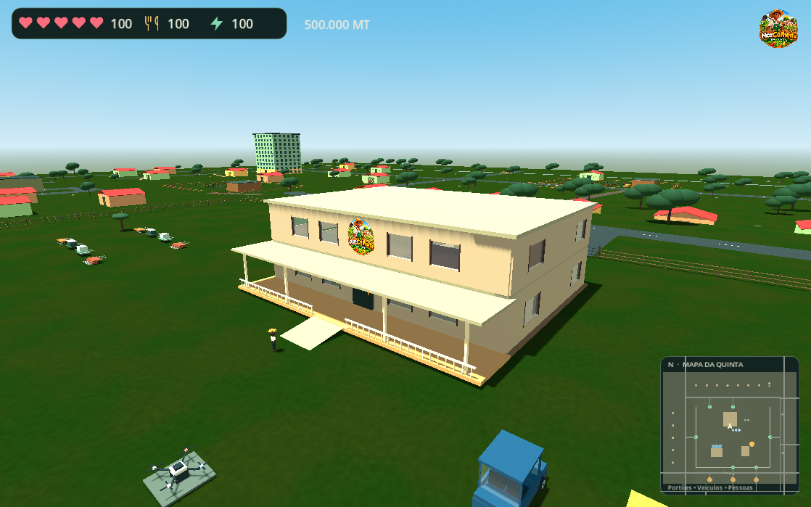
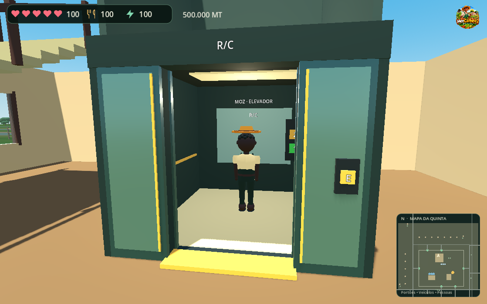
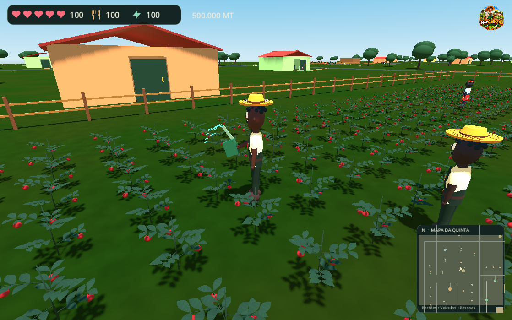
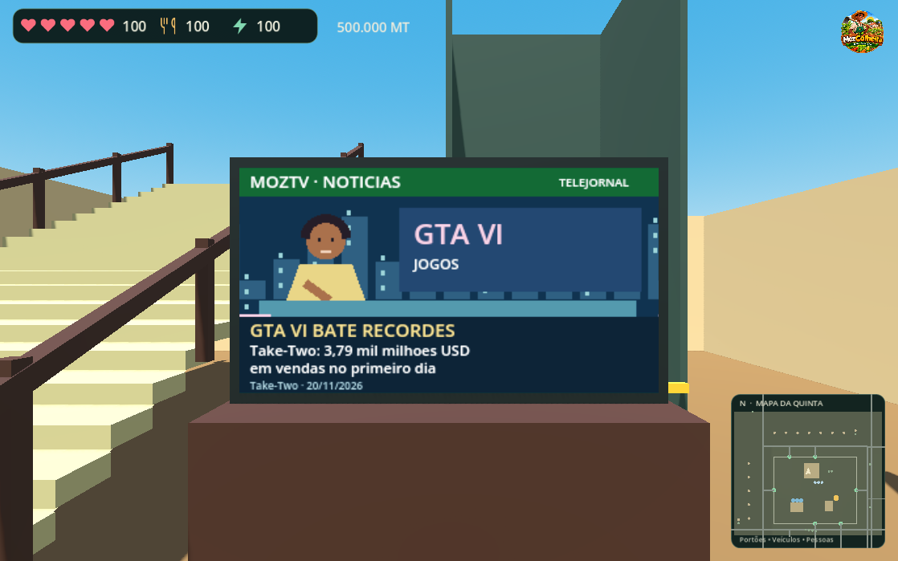
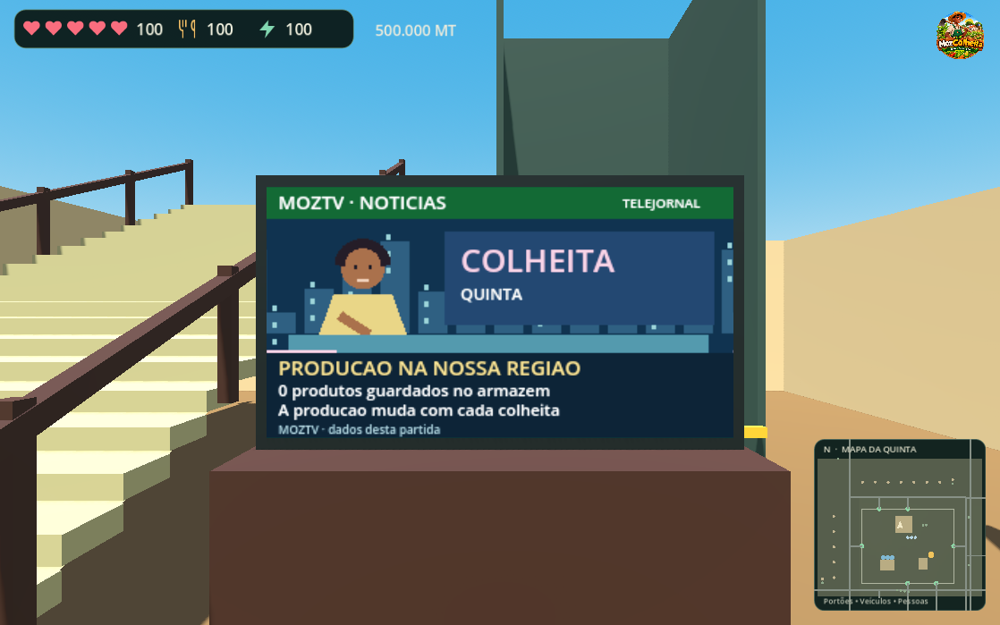

<div align="center">
  
  <h1>MozColheita</h1>
  <p>Da primeira semente à entrega na fábrica: constrói a tua rotina agrícola em Moçambique.</p>
</div>

**MozColheita** é um jogo de simulação agrícola 3D com personagens de estilo cartoon, produção de alimentos, máquinas, trabalhadores e uma comunidade à volta da quinta. Começas com **500.000 MT**, uma casa e terreno por preparar. Decides o que cultivar, como organizar o trabalho e quais encomendas aceitar.

O projecto combina aprendizagem sobre agricultura e gestão com desafios de produção, condução, logística e planeamento. A implementação activa está **nesta pasta principal**, em GDScript tipado, validado no **Godot 4.6**.



## Índice

- [Começar a jogar](#começar-a-jogar)
- [Primeiros passos](#primeiros-passos)
- [O que torna o jogo divertido](#o-que-torna-o-jogo-divertido)
- [Agricultura e rotação](#agricultura-e-rotação)
- [Casa, descanso e alimentação](#casa-descanso-e-alimentação)
- [Máquinas, transporte e armazém](#máquinas-transporte-e-armazém)
- [Missões, empresas e contratação](#missões-empresas-e-contratação)
- [Controlos](#controlos)
- [Mundo e personagens](#mundo-e-personagens)
- [Telejornal MOZTV](#telejornal-moztv)
- [Guardar e continuar](#guardar-e-continuar)
- [Organização técnica](#organização-técnica)
- [Verificar e contribuir](#verificar-e-contribuir)
- [Ficheiros e Git](#ficheiros-e-git)
- [Limitações e próximos passos](#limitações-e-próximos-passos)

## Começar a jogar

Utiliza **Godot 4.6** com o renderizador **GL Compatibility**. A configuração do projecto declara a família Godot 4.3, mas a validação desta versão foi feita em 4.6.

1. Abre o `project.godot` desta pasta no Godot e executa o projecto com F5.
2. Em Linux, também podes executar `./Jogar.sh` no terminal.
3. No menu, escolhe agricultor ou agricultora e **Jogar nesta sessão**, ou **Continuar quinta guardada** para retomar.

O lançador procura a instalação local configurada e, como alternativa, `godot` no PATH. Para indicar outra instalação:

```sh
MOZCOLHEITA_GODOT=/caminho/para/godot ./Jogar.sh
```

**F5 dentro do jogo guarda a quinta.** No editor, F5 executa o projecto. Não é necessário usar a pasta `fazenda-3d`.

## Primeiros passos

1. Uma sessão nova começa **deitado na cama**, à noite, com o cônjuge ao lado. O sono avança até amanhecer; permanece na cama até premir **E** para levantar. Depois explora a casa, a quinta, as máquinas e os seis portões.
2. Abre **K**, escolhe a **enxada** e prepara uma pequena área livre. A quinta começa sem parcelas lavradas.
3. Escolhe a cultura em **H → Culturas**. Usa a **semeadora manual** e depois o **regador**.
4. A primeira rega inicia o crescimento. Espera **três dias completos de jogo** desde essa rega.
5. Quando estiver maduro, selecciona **mãos livres** e colhe. Os produtos vão para a sacola, com som, partículas e indicação da quantidade.
6. Guarda a produção no armazém ou transporta-a para uma fábrica. Consulta **H → Entregas** antes de assumir uma encomenda.
7. Começa por encomendas pequenas. Aumenta a produção e contrata ajuda quando conseguires coordenar sementes, espaço de carga e prazo.

Para uma primeira experiência, prepara poucos canteiros e completa um ciclo inteiro. Depois experimenta executar as mesmas tarefas com tractor e máquinas.

## O que torna o jogo divertido

| Experiência | O que podes fazer agora |
|---|---|
| Ver a quinta transformar-se | Abrir sulcos, plantar, regar e acompanhar culturas com formas e fases próprias. |
| Conduzir e operar máquinas | Alternar trabalho manual, tractor, implementos, carrinhas, camião e drone de irrigação. |
| Resolver desafios de produção | Escolher encomendas pequenas, regulares ou grandes e decidir se o prazo compensa a recompensa. |
| Organizar uma equipa | Distribuir tarefas ou contratar até dez pessoas para produzir e carregar uma encomenda. |
| Planear uma entrega | Gerir capacidade, carregar produtos e seguir a rota até à garagem da empresa certa. |
| Melhorar resultados | Rodar culturas, cuidar do solo e construir reputação com as empresas para obter melhores ofertas. |
| Criar uma rotina | Trabalhar na quinta, viajar com companhia, comer à mesa, assistir ao telejornal e dormir até amanhecer. |
| Acompanhar a comunidade | Ver vizinhos a plantar e regar, moradores nos quintais e notícias sobre a tua produção. |
| Explorar | Visitar os arredores, quintas vizinhas, bairros, estradas e riacho, de dia ou à noite. |

O desafio está nas escolhas: trabalhar sozinho ou pagar ajuda, vender já ou reservar para uma encomenda, aceitar urgência ou produzir com mais margem. A meta de produção recompensa colheitas efectivas; as entregas acrescentam objectivos com consequências financeiras.

## Agricultura e rotação

A quinta mede **192 × 156 m**, com terreno natural e seis portões. Edifícios, acessos, estacionamentos e zonas reservadas não podem ser cultivados.

**Preparar → semear → regar → crescer → colher** é a sequência comum às ferramentas, máquinas e trabalhadores. Sementes secas não crescem. Tomate, milho, couve e cenoura têm malhas, cores e estágios próprios.

O solo guarda humidade, saúde e a família da cultura anterior. Repetir a mesma família penaliza o rendimento; alternar culturas pode melhorar o resultado. Consulta as informações da parcela e as recomendações disponíveis na gestão.

Um dia dura **dez minutos reais** em velocidade normal. **L** alterna para as 18:00 e depois para as 06:00 do dia seguinte, com céu e iluminação correspondentes e canto de galo na nova manhã. Não existe um botão de calendário permanente no HUD.

**Avançar o tempo ou dormir também avança culturas e prazos.** Os trabalhadores continuam a precisar de percorrer fisicamente os seus caminhos; saltar tempo não executa instantaneamente as tarefas deles.

## Casa, descanso e alimentação

A casa principal tem **dois pisos**, varanda coberta e lajes de betão. O logótipo fica na fachada do segundo piso, acima da porta. O rés-do-chão tem sala com sofá e televisão, corredor e cozinha; em cima ficam quarto de casal, roupeiro e casa de banho com lavatório, sanita e duche. Escadas e elevador ligam os pisos. Há janelas transparentes, incluindo junto à cama. O casal dorme de barriga para cima, próximo e com os braços em abraço; as duas almofadas ficam alinhadas junto à cabeceira de madeira.

| Local / tecla | Comportamento |
|---|---|
| Cama + E, de dia | Senta na cama. Permanece até E para sair. |
| Cama + E, à noite | Deita-se com o cônjuge e avança até às 06:00. Acorda na cama e só sai com E. |
| Mesa + E | Senta; E novamente come com alimento na mão e animação. WASD/Esc levanta; E também permite levantar após a refeição. |
| Sofá + E | Senta e liga a televisão. O canal MOZTV mostra notícias variadas de jogos, cultura, agricultura e da comunidade, com fontes; continua até interromper com E/WASD/Esc. Espaço liga/desliga o aparelho. |
| Roupeiro + E | Alterna quatro conjuntos de roupa, conservados na gravação. |
| Duche + E | Entra, fecha a cortina de pano opaco e só depois liga a água. E pára a água, abre a cortina para sair e repõe a roupa anterior. |
| Sanita + E | Usa sentado; E termina. |
| Elevador + E | Chama a cabine e entra quando as portas abrem. Dentro: 1 rés-do-chão, 2 piso do quarto, E sai sem viajar. |
| C durante uma actividade | Convida o cônjuge para a mesa, sofá, cama ou duche. Dormir à noite reúne o casal automaticamente. |

A mesa começa com **quatro refeições**. Depois usa um produto da sacola ou do armazém. Cada refeição recupera até 35 de alimentação, 30 de energia e 10 de vida; não há consumo quando as necessidades já estão completas nem duplicação por premir repetidamente durante a animação. A refeição é partilhada visualmente com a companhia presente. Fora da mesa, J mantém a alimentação por produtos consigo ou junto ao armazém.

Dormir recupera energia, até 15 de vida e consome 8 de alimentação. **Sono avança culturas e prazos e pode causar quebra de contrato.** Acordar não executa instantaneamente os percursos dos funcionários. A higiene diminui lentamente durante a sessão e recupera no duche/sanita; não há penalização de produção por higiene nesta versão.

O duche tem cortina animada com pregas e laterais opacas. Com **C**, a água pára, a cortina abre para receber o cônjuge e volta a fechar antes de retomar o banho. A cortina fica aberta depois da saída; a higiene só recupera enquanto a água corre.

O elevador tem cabine iluminada, corrimãos, painel de botões, indicador de piso e portas duplas na cabine e nos dois patamares. Se estiver noutro piso, vem vazio para receber o jogador. **Só viaja com todas as portas fechadas**; um sensor impede o fecho sobre uma personagem no limiar. Ao chegar, abre e o jogador sai no patamar. As portas do piso sem cabine permanecem fechadas.



A porta da casa abre por proximidade, de ambos os lados. Os tectos de betão mantêm-se presentes na câmara normal. A câmara livre e capturas de enquadramento permitem cortes visuais para mostrar os interiores, mantendo as colisões. Mobília inclui cama de casal, almofadas, sofá de dois lugares, mesas, cadeiras, armário, estantes, bancada e frigorífico decorativos.

### Companhia familiar

O cônjuge é adulto: por predefinição, o agricultor tem esposa (Ester) e a agricultora tem marido (Mateus). **H → Família** permite escolher companheira ou companheiro independentemente da personagem.

**C** chama a companhia, que percorre os corredores, escadas e caminhos da quinta. Nas actividades da casa, ocupa o lugar ao lado. Num tractor, camião ou automóvel parado, aproxima-se e embarca no segundo banco. Sai quando o condutor pára e sai. **X passa a transferir carga**, deixando C livre para chamar companhia.

As rotinas partilhadas são apresentadas com as personagens vestidas; no banho usam conjunto de lazer. A companhia não substitui os funcionários contratados nem cobra serviços agrícolas. Na retoma, ambos regressam a pé, sem posições de ocupação temporárias.

Corações representam vida; talheres representam alimentação (**100 = saciado**); o raio representa energia. Sem alimento a vida desce lentamente até 20; não há morte automática implementada.

## Máquinas, transporte e armazém

| Equipamento | Quantidade / capacidade | Utilização |
|---|---|---|
| Tractores | 3 | Conduzir e operar um implemento engatado de cada vez. |
| Implementos | 12 | Preparar solo, semear, irrigar e colher. |
| Carrinhas / reboques | 3; 120 unidades cada | Transportar produtos com tractor. |
| Camião | 1; 500 unidades; 2 lugares | Carregar e entregar encomendas nas empresas. |
| Automóveis familiares | 2; 2 lugares cada | Conduzir e viajar com companhia. |
| Drones agrícolas | 3 | Voo remoto e irrigação. O agricultor permanece no local de lançamento. |

Um **indicador verde** assinala o equipamento disponível. Aproxima o tractor, pára e usa **G** para engatar/soltar. **Espaço** liga/desliga a máquina. **W + T** activa turbo e **Ctrl** trava. O condutor fica visível no veículo.

Cada semeadora tem depósito de **300 sementes**. **B** repõe as sementes em falta a **2 MT por unidade**; H → Mercado permite abastecer máquinas dos funcionários. Contratos individuais não compram sementes silenciosamente.

A garagem/armazém tem duas portas automáticas. Entrar carregado deposita os produtos. Sair conserva o stock. Depois, uma nova entrada com carrinha ou camião vazio carrega produtos até à capacidade; excedentes ficam guardados. **X** permite transferências com o veículo parado. Caixas abertas mostram os produtos e as quantidades reais.

Faróis de carros, tractores e camião e luzes dos drones acendem automaticamente à noite. Os ícones de condução aparecem apenas ao conduzir/pilotar, com a tecla no centro de cada ícone. O HUD mantém vida, alimentação, energia, saldo, logótipo e minimapa; ferramentas e missões ficam nos painéis K/H.

## Missões, empresas e contratação

### Produção e encomendas

A meta inicial de produção é **colher 500 tomates**, com recompensa de **15.000 MT**. Existem metas seguintes para outras culturas. É contada a colheita real, incluindo a produção dos trabalhadores.

Em **H → Entregas**, escolhe o tamanho da encomenda e a urgência. Antes de aceitar, consulta quantidade, prazo, recompensa, multa, estimativa de equipa, margem e distância aproximada. A estimativa não substitui o orçamento real de contratação.

| Empresa | Produtos aceites | Garagem principal (X, Z) |
|---|---|---|
| Tomates do Zambeze | Tomate | (-60, 110) |
| Moageira Nhamatanda | Milho | (0, 110) |
| Hortícolas Maputo | Couve e cenoura; encomendas de couve | (60, 110) |

Há também filiais: **seis locais de entrega**, correspondentes a três empresas. Com mercadoria compatível, uma seta e o minimapa indicam o caminho, dando prioridade às encomendas activas. Conduz o camião para dentro da garagem e pára para entregar.

Encomendas regulares têm prazos base de **8/6/4 dias**, conforme a urgência. Pequenas e grandes ajustam o prazo, com mínimo de quatro dias; o valor exacto aparece na oferta. Maior urgência aumenta recompensa e penalização. O preço aceite fica fixado.

- Entregas parciais pagam as unidades aceites. Completar a quantidade a tempo paga o bónus e melhora a reputação.
- Ao chegar aos últimos 20% do prazo, aparece um aviso temporário.
- Falhar o prazo quebra o contrato e desconta a multa aprovada **uma única vez**. O saldo pode ficar negativo.
- Sucessos e falhas ficam em **H → Histórico**. A reputação altera os preços de ofertas futuras e é guardada.

### Contratar pessoas

**Individualmente:** E junto de um NPC abre uma proposta. É obrigatório escolher a tarefa, a quantidade e a parcela, com tractor e empresa quando aplicável. Só depois de confirmar o orçamento começa o aperto de mão e o trabalho. Até três contratos individuais podem reservar tractores exclusivos.

**Em grupo:** em H → Grupo, associa uma equipa de **1–10 trabalhadores** a uma encomenda aceite. Define empresa, dificuldade e centro da parcela; estaciona o camião com espaço e confirma o orçamento. Existe uma equipa de produção activa de cada vez.

A equipa prepara, planta, rega, aguarda crescimento, colhe e carrega. Usa tractores e equipamentos disponíveis; os restantes trabalhadores recorrem a ferramentas manuais. O jogador recebe aviso quando a carga está pronta e faz a entrega final.

O pagamento varia com tarefa, quantidade, dificuldade e procura. A proposta discrimina o máximo reservado; o trabalho não executado é devolvido ao cancelar. Cancelar uma equipa **não cancela a encomenda nem o prazo**. A multa de uma encomenda não se multiplica pelo número de trabalhadores.

## Controlos

| Tecla / entrada | Acção |
|---|---|
| WASD / Shift | Andar / correr; WASD conduz veículos. À mesa, WASD levanta. |
| Rato / roda / + / − | Olhar / zoom. No kit K, a roda selecciona ferramentas. |
| K / 1–6 | Kit: 1 mãos, 2 martelo, 3 serrote, 4 enxada, 5 regador, 6 semeadora. |
| Clique / Espaço | Usar ferramenta; no tractor, ligar/desligar implemento. |
| E | Interagir, contratar, entrar/sair de veículo parado; na casa usa cama, mesa, sofá, roupeiro, duche, sanita e elevador. |
| G | Engatar/soltar implemento ou carrinha com tractor parado. |
| W + T / Ctrl | Turbo / travão no veículo. |
| C / X | Chamar companhia / transferir ou vender carga com veículo parado. |
| B | Abastecer semeadora próxima ou engatada. |
| F | Assumir/devolver drone. |
| WASD / Espaço / Ctrl / R no drone | Voar / subir / descer / ligar-desligar irrigação. |
| H | Gestão: culturas, equipa, mercado, entregas, grupo, histórico e controlos. |
| J | Comer produto fora da mesa. |
| L | Alternar noite e manhã seguinte. |
| V | Câmara livre; WASD move, Q/E altera altura, V regressa. |
| F5 / F9 | Guardar / retomar a quinta. |
| Tab / Esc | Cursor / fechar painel, cancelar proposta ou abrir menu. À mesa, Esc levanta. |

**Na casa:** E levanta da cama depois de acordar; de dia, a cama serve para sentar. No duche, E pede a saída com abertura da cortina; C convida a companhia. No sofá, Espaço liga/desliga a TV.

Martelo constrói/repara cercas; serrote corta as árvores interactivas; enxada prepara solo. Estufas construíveis ainda não estão implementadas.

Há suporte parcial a comando reconhecido pelo Godot para condução/drone; a interface mostra as teclas do teclado. Não há validação com hardware de comando físico e a deslocação a pé continua a utilizar teclado/rato.

## Mundo e personagens

Mapa finito de **800 × 800 m**, com relevo suave, **seis quintas vizinhas**, **55 casas**, **dez prédios** de 10/20/40 pisos, **46 NPCs** e **vinte veículos de ambiente**. Estradas asfaltadas e de terra, árvores, pedras, riacho e pontes ligam a comunidade. Há criações com porcos, galinhas e bovinos e agricultores vizinhos a trabalhar. **40 moradores têm rotinas próprias**, incluindo 12 agricultores nas seis quintas: percorrem linhas de cultura e alternam preparação, sementeira, rega com água visível e colheita. Adultos cuidam dos canteiros e quintais; crianças brincam e idosos passeiam ou descansam. Ao anoitecer, os moradores regressam às casas pelas portas e retomam a actividade ao amanhecer.

Cada morador recebe uma residência; os casais das quintas têm lugares separados na entrada e no descanso. Estas rotinas são de ambiente e alteram algumas plantas locais visualmente; não geram mercadoria, salários ou progressos nas missões do jogador. Contratos e conversas interrompem a rotina e recolhem as ferramentas.

Casas da comunidade e átrios dos prédios têm portas automáticas; os andares altos são cenário. O trânsito segue circuitos no centro das estradas, pára perante obstáculos e não executa ultrapassagens.

**Cinco opções de corpo** no menu e em H → Família: médio, alto, baixo, robusto e magro. A escolha é guardada e mantém-se nas poses domésticas e nos veículos. A comunidade inclui crianças, adultos e idosos, com alturas, volumes, roupas e tons de pele diferentes; os idosos têm cabelo grisalho e traços próprios. As crianças não são contratáveis. Duas pessoas fazem actividades de manutenção de ambiente junto à quinta; a produção efectiva continua a depender do jogador ou dos contratos.

Agricultor e agricultora seguem o estilo do logótipo: pele castanha, roupa creme e verde, bandeira de Moçambique e botas. O agricultor usa chapéu de palha; a agricultora tem lenço, brincos e tecido inspirado na capulana. Partilham controlador e rig, com animações procedurais de caminhada, corrida, plantio, rega, colheita, transporte, condução e interacções domésticas. Há ambiente sonoro rural e conversas simples entre NPCs/jogador.



## Telejornal MOZTV

A MOZTV tem **12 notícias**, misturadas em cada edição, que mudam automaticamente a cada **sete segundos**. Uma notícia só se repete depois de passarem todas as outras; o sistema evita repetir a última na edição seguinte e alterna temas quando possível. Há jogos, cultura, agricultura, economia e comunidade. O painel do estúdio muda com o assunto e a apresentadora continua animada.

A cobertura do **GTA VI** trata dos recordes de vendas e reconhecimento da crítica divulgados pela Take-Two, música, rádios, lugares e protagonistas. As notícias externas foram verificadas em **22/11/2026** e identificam a fonte; não são anúncios de um lançamento futuro. Fontes: [Take-Two — comunicado de resultados do GTA VI](https://www.sec.gov/Archives/edgar/data/946581/000162828026075217/exhibit9918k.htm), [Rockstar Games](https://www.rockstargames.com/VI) e [Newswire](https://www.rockstargames.com/newswire?tag=vi).

Os boletins da própria partida são **dinâmicos**: mostram quantidades reais no armazém, encomendas activas, entregas concluídas, trabalhadores contratados e actividade diurna/nocturna. Os dados mudam enquanto o jogador joga. As notícias externas ficam no catálogo local e não são actualizadas automaticamente pela Internet. O telejornal conserva o ponto em que ficou ao desligar/ligar a TV durante a sessão.





## Guardar e continuar

**F5** guarda, **F9** retoma. Existe gravação automática a cada minuto real durante uma sessão activa e ao sair pelo menu/fecho normal. O menu inicial apresenta **Continuar quinta guardada** quando existe uma gravação.

O ficheiro fica em `user://quinta.mozsave`, na pasta de dados do Godot para MozColheita. Tem verificação SHA-256, escrita temporária e cópia `.bak` para recuperação. Existe um slot local com cópia de segurança.

São conservados dinheiro, inventário, solo/rotação/culturas, sementes, ferramentas, veículos/cargas/engates, cercas, árvores, missões, prazos, histórico, reputação, necessidades/higiene, refeições, roupa, tipo de corpo, preferência de companhia, automóveis e trabalho contratado.

O relógio não avança com o jogo fechado. A retoma é feita a pé, sem poses temporárias, veículos parados, máquinas desligadas e velocidade normal. Os trabalhadores retomam as tarefas. Gravações anteriores sem refeições domésticas recebem as quatro refeições iniciais por compatibilidade. A gravação aguarda o fim do sono ou da negociação/aperto de mão.

## Organização técnica

Não são necessários plugins nativos. `main.tscn` inicia a composição dos sistemas; a maior parte do mundo é criada proceduralmente por GDScript.

| Área | Ficheiros principais em `scripts/` |
|---|---|
| Composição e interacções | `main.gd`, `player.gd`, `camera.gd` |
| Agricultura | `terrain.gd`, `crop.gd`, `tools.gd`, `farm_feedback.gd` |
| Calendário e necessidades | `calendar.gd`, `daylight.gd`, `vitals.gd` |
| Casa e família | `farmhouse.gd`, `house_architecture.gd`, `house_interior.gd`, `home_life.gd`, `family.gd`, `house_elevator.gd` |
| Cortina e sequência do duche | `shower_curtain.gd` |
| Rotinas da comunidade | `community_routine.gd`, `npc.gd` |
| Televisão | `television.gd`, `tv_program.gd`, `tv_news.gd` |
| Veículos e máquinas | `tractor.gd`, `car.gd`, `truck.gd`, `trailer.gd`, `implement.gd`, `drone.gd` |
| Arte e entradas dos veículos | `vehicle_art.gd`, `vehicle_lights.gd`, `input_drive.gd` |
| Economia e objectivos | `economy.gd`, `missions.gd`, `deliveries.gd` |
| Trabalhadores | `npc.gd`, `contract.gd`, `crew.gd`, `tasks.gd`, `navigation.gd` |
| Comunidade e acessos | `community.gd`, `world_details.gd`, `traffic.gd`, `residence.gd`, `layout.gd` |
| Armazém e empresas | `warehouse.gd`, `factory.gd`, `produce_crate.gd` |
| Interface | `hud.gd`, `driving_hud.gd`, `minimap.gd`, `delivery_route.gd` |
| Persistência | `persistence.gd` |

`icons/` contém os ícones SVG; `MozColheita-icon.png` é a identidade do projecto. `validation/` reúne testes e registos; `preview/` reúne capturas. Quando presente, `.mozcolheita-anterior/` é uma cópia de uma versão anterior; o projecto activo é o `project.godot` da raiz.

Culturas e decoração usam MultiMesh; malhas/materiais são partilhados sempre que possível. Os efeitos agrícolas reutilizam pequenas reservas de partículas/texto, e actores distantes têm visibilidade limitada. A navegação combina percursos globais e desvio local. Faróis não projectam sombras e têm atenuação por distância.

## Verificar e contribuir

Executa os comandos a partir da raiz. Os testes alteram a sessão de teste; testes de persistência usam ficheiros isolados, sem escrever na quinta do jogador.

```sh
# Arranque
./Jogar.sh --headless --quit-after 5

# Agricultura, veículos e logística
./Jogar.sh --headless -- --teste
./Jogar.sh --headless -- --teste-veiculos
./Jogar.sh --headless -- --teste-logistica

# Contratos, persistência e grupo de trabalhadores
./Jogar.sh --headless --script validation/comunidade/deadlines.gd
./Jogar.sh --headless --script validation/diversao/persistence_test.gd
./Jogar.sh --headless --script validation/comunidade/test.gd

# Casa de dois pisos, família, corpos e veículos de dois lugares
./Jogar.sh --headless --script validation/familia/test.gd
./Jogar.sh --headless --script validation/elevador/test.gd

# Rotinas dos moradores e telejornal dinâmico
./Jogar.sh --headless --script validation/rotinas/test.gd
./Jogar.sh --headless --script validation/telejornal/test.gd
```

Cada teste escreve o resultado no terminal e termina com código de saída zero quando passa. Podes guardar o terminal num `.log` local; estes registos são ignorados pelo Git. Os scripts de teste permanecem versionados. Para reproduzir as capturas é necessário um ambiente gráfico:

```sh
./Jogar.sh --script validation/familia/capture.gd
./Jogar.sh --script validation/familia/capture_cama.gd
./Jogar.sh --script validation/familia/capture_duche.gd
./Jogar.sh --script validation/elevador/capture.gd
./Jogar.sh --script validation/rotinas/capture.gd
```

Ao alterar um sistema: mantém GDScript tipado, usa as acções comuns do terreno/economia/calendário, preserva a compatibilidade da gravação, executa as verificações relevantes e actualiza esta documentação. Para elementos visuais, revê capturas do jogo além do arranque headless.

## Ficheiros e Git

O `.gitignore` exclui caches do Godot (`.godot/`, `.mono/`), exportações e builds locais, logs, ficheiros temporários, gravações `.mozsave` com as suas cópias e configuração privada local. A cópia antiga `.mozcolheita-anterior/` e a pasta local `.kombai/` também ficam excluídas de novas adições.

Mantém no repositório os scripts, cenas, shaders, dados do terreno, ícones, logótipo, testes e imagens de documentação em `preview/`. Os ficheiros **`.uid`** dos scripts/shaders e **`.import`** dos assets podem ser versionados: guardam identidades e configurações de importação, enquanto o conteúdo processado fica na cache `.godot/`. Referências: [UIDs no Godot](https://godotengine.org/article/uid-changes-coming-to-godot-4-4/) e [processo de importação](https://docs.godotengine.org/en/stable/tutorials/assets_pipeline/import_process.html).

O `.gitignore` aplica-se a ficheiros ainda não versionados. Logs e cópias antigas já acompanhados pelo Git continuam no índice até uma remoção explícita; alterar a regra não apaga esses ficheiros. Ao rever um commit, verifica `git status --short` e `git diff --check`.

## Limitações e próximos passos

Esta versão é uma simulação jogável em evolução. Avatares, móveis e animações são procedurais; edifícios altos e animais têm comportamento de cenário. Não existe economia urbana autónoma, reprodução animal, ultrapassagem no trânsito ou interacção com todos os móveis.

Guardar depende da composição actual do mapa; futuras mudanças de entidades precisam de migração. Não há múltiplos slots nem sincronização na nuvem. A última entrega à fábrica continua sob responsabilidade do jogador.

Possíveis expansões **ainda não implementadas**: eventos sazonais, histórias e relações com vizinhos, festivais, melhoramentos compráveis para a quinta, culinária com receitas e estufas construíveis. O README descreve acima o que existe; estas ideias não são funcionalidades disponíveis.

## Guia e licença

- [Guia rápido dos controlos](COMO_JOGAR.txt)
- [Licença GNU GPL v3](LICENSE)

Este README concentra a documentação actual do projecto.
