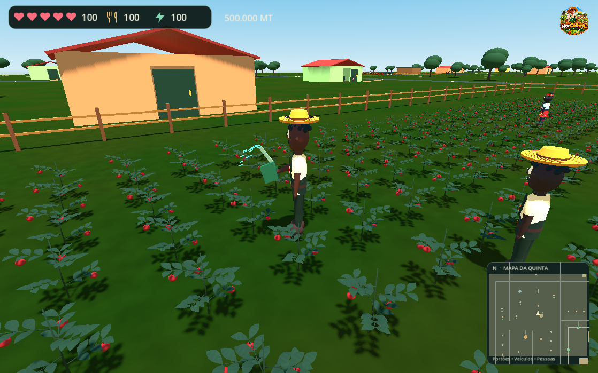
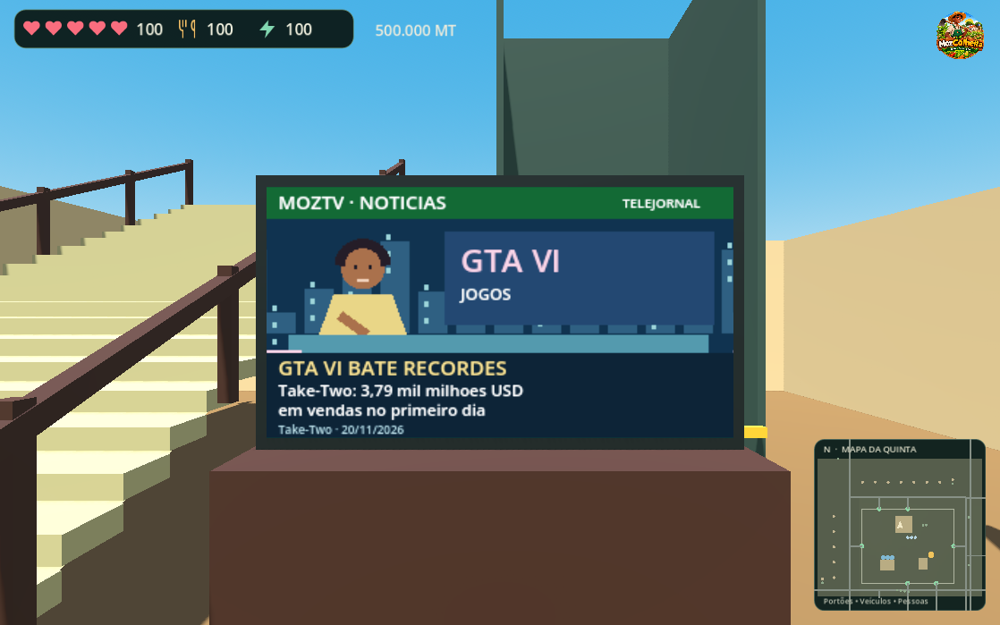

# Comunidade viva e notícias na televisão

## Rotinas dos moradores

Os 46 NPCs existentes foram preservados, mantendo a compatibilidade das gravações. Quarenta receberam rotinas próprias; os seis candidatos e ajudantes junto à quinta conservam os seus percursos.

- Doze agricultores, dois por quinta vizinha, circulam entre pontos nas linhas de cultura. Alternam preparação, sementeira, rega e colheita. Usam enxada ou regador conforme a tarefa; a rega tem partículas de água. Algumas plantas locais mudam de tamanho ao longo do ciclo.
- Adultos residentes cuidam dos canteiros e quintais, passeiam e descansam dentro de casa. Crianças brincam no quintal; idosos passeiam, gesticulam e descansam.
- Ao anoitecer, regressam a residências reais pelo acesso frontal; as portas existentes abrem por proximidade. Ao amanhecer, retomam o percurso exterior. Moradores recebem casas distintas; agricultores da mesma quinta têm posições de descanso separadas.
- Contratação e conversas têm prioridade: ferramentas e água da rotina de ambiente são suspensas. Os trabalhadores continuam a executar os contratos pagos existentes.

As rotinas usam movimento físico, desvio de obstáculos e separação entre NPCs já existentes. Não há teletransporte de moradores quando se salta o tempo.

## MOZTV — telejornal variado

O estúdio animado tem doze notícias e muda de assunto a cada sete segundos. A ordem é misturada em cada edição, evitando repetir antes de esgotar as notícias e sem repetição imediata entre edições. Os temas alternam quando possível. O painel apresenta o tema de cada notícia; a apresentadora mantém-se animada. O móvel não tapa o rodapé.

GTA VI é tratado como um jogo já disponível: recordes e reconhecimento da crítica divulgados pela Take-Two, música, rádios, lugares e protagonistas. A notícia sobre vendas atribui à Take-Two os 3,79 mil milhões de dólares no primeiro dia. Fontes externas verificadas em **22/11/2026**: [comunicado da Take-Two](https://www.sec.gov/Archives/edgar/data/946581/000162828026075217/exhibit9918k.htm), [Rockstar Games](https://www.rockstargames.com/VI) e [Newswire](https://www.rockstargames.com/newswire?tag=vi).

Outros boletins apresentam agricultura, armazém, encomendas, emprego e comunidade. Stock, entregas, funcionários e hora local vêm do estado real da partida e actualizam-se enquanto o jogo decorre. Não são números inventados. Notícias externas ficam no catálogo local; não existe recolha automática de notícias da Internet.

E no sofá liga a TV; Espaço liga/desliga; E/WASD/Esc termina a actividade. Desligar/ligar mantém a sequência durante a sessão.

## Ficheiros

Criados:

- `scripts/tv_news.gd` — catálogo de notícias e boletins dinâmicos.
- `validation/telejornal/test.gd` — rotação, variedade e dados dinâmicos.

- `scripts/community_routine.gd` — rotinas, calendário, ferramentas e cuidados com culturas locais.
- `validation/rotinas/test.gd` — testes integrados de movimento, rega, ciclo agrícola, casas e TV.
- `validation/rotinas/capture.gd` — capturas reproduzíveis.
- `preview/rotinas/televisao-gta-vi.png`, `preview/rotinas/vizinho-a-regar.png` — verificações visuais.
- `RELATORIO_COMUNIDADE_VIVA.md` — este relatório.

Modificados:

- `scripts/main.gd` — atribuição das rotinas e residências após construir a comunidade.
- `scripts/npc.gd` — execução de rotinas com prioridade para contratos/conversas.
- `scripts/tv_program.gd`, `scripts/television.gd` — programação contínua e integração com dados da partida.
- `scripts/home_life.gd`, `scripts/house_interior.gd` — altura do ecrã e moldura da TV.
- `README.md`, `COMO_JOGAR.txt` — documentação das rotinas e do boletim.

## Validação

Godot 4.6 headless: `./Jogar.sh --headless --script validation/rotinas/test.gd`.

Resultado em `validation/rotinas/final-acessos.log`: **PASSOU, 0 falhas**. Verifica 40 moradores/12 agricultores, quatro tarefas, movimento físico na machamba, regador com água, suspensão de ferramentas, entrada física pela porta à noite, retoma de manhã, economia intacta e conteúdo da TV.

Regressão dos contratos e produção: `validation/rotinas/contratos.log`, gerado por `validation/comunidade/test.gd`: **PASSOU, 0 falhas**.

Capturas OpenGL por software em `validation/rotinas/visual.log`; a advertência de V-Sync é do controlador gráfico.

Telejornal: `validation/telejornal/test.log`, **PASSOU, 0 falhas**. Verifica 12 notícias sem repetição na edição, mudança automática, cem transições sem repetição imediata e actualização do boletim de stock.

## Limites

As actividades das quintas vizinhas são de ambiente: não geram stock, pagamentos ou progresso para as missões do jogador. A ordem das culturas é cíclica e não simula uma economia autónoma. Os moradores descansam em posições de interior; não usam todas as interacções domésticas do jogador. A conversa dos moradores é representada por gestos e pelos diálogos já existentes. Saltar dias muda o destino da rotina, mas não executa instantaneamente os percursos.

Nome de commit sugerido:

`feat: dar vida à comunidade e adicionar notícias do GTA VI à televisão`
