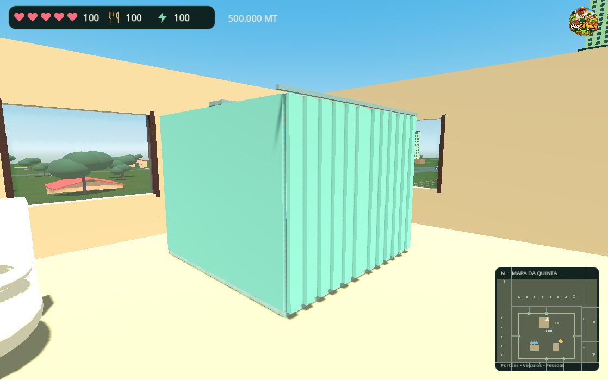

# Casa, família e personagens — MozColheita

## Comportamento entregue

A casa principal passou a ter dois pisos, sala, corredor, cozinha, quarto de casal e casa de banho. Escadas e elevador permitem chegar ao piso superior. Foram repostos os tectos de betão e a varanda coberta; o logótipo está na fachada do segundo piso. Há janelas transparentes junto à cama e nas restantes divisões.

Uma partida nova começa à noite, com o agricultor já deitado na cama e o cônjuge ao lado; acorda de manhã e permanece na cama até E. De dia, E na cama apenas senta; à noite, deita o casal e avança até às 06:00. O jogador permanece na cama até premir E. O tempo avançado também afecta culturas e prazos dos contratos.

A mesa permite comer com produto na mão e animação. O sofá liga um programa agrícola animado que continua até o jogador interromper. O roupeiro alterna quatro paletas de roupa. Sanita e duche recuperam higiene.

A pose de sono mantém os rostos virados para cima, com os corpos próximos e os braços interiores em abraço. As almofadas ficam do mesmo lado, junto à cabeceira de madeira. O alinhamento da cabeça adapta-se à altura do avatar.

### Duche com privacidade

O duche tem cortina de pano opaco com pregas, duas metades deslizantes e laterais opacas. A sequência é: entrar → fechar cortina → ligar água. A câmara fica fora da cortina. Só há recuperação de higiene com água ligada.

C convida o cônjuge: a água pára, a cortina abre para a sua entrada e fecha novamente antes de retomar a água. E, movimento ou Esc pedem a saída: a água pára primeiro, o pano abre, as personagens saem e a cortina fica aberta. A roupa anterior é reposta.

### Companhia e diversidade

O cônjuge adulto caminha pela casa e quinta para se juntar ao jogador. C chama para mesa, sofá, duche ou banco de passageiro; o sono nocturno reúne o casal automaticamente. H → Família permite escolher companheiro/companheira e corpo. Há cinco perfis: médio, alto, baixo, robusto e magro. A comunidade inclui adultos, idosos e crianças; crianças não podem ser contratadas.

Dois automóveis familiares, os três tractores e o camião têm condutor e passageiro visíveis. C chama a companhia; X transfere carga. O desembarque ocorre com o veículo parado.

## Ficheiros desta fase

Criados:

- `scripts/house_architecture.gd`: estrutura, divisões, escadas, janelas, varanda e lajes.
- `scripts/house_interior.gd`: mobília e plataforma do elevador.
- `scripts/home_life.gd`: interacções domésticas, sono, refeições, higiene e introdução.
- `scripts/shower_curtain.gd`: pano e sequência de entrada, banho partilhado e saída.
- `scripts/family.gd`: companhia adulta, percursos e actividades partilhadas.
- `scripts/car.gd`: automóveis familiares de dois lugares.
- `scripts/television.gd` e `scripts/tv_program.gd`: ecrã e programa animado.
- `validation/familia/test.gd`: verificações integradas.
- `validation/familia/capture.gd`, `validation/familia/capture_duche.gd` e `validation/familia/capture_cama.gd`: capturas reproduzíveis.
- `preview/familia/*.png`: imagens da casa, interiores, veículos, personagens e cortina.
- `RELATORIO_FAMILIA.md`: este relatório.

Actualizados nesta fase (alguns já existiam como alterações locais de fases anteriores):

- `scripts/farmhouse.gd`, `scripts/layout.gd`: composição e espaço da casa.
- `scripts/main.gd`, `scripts/hud.gd`: integração, selecção de corpo e família.
- `scripts/player.gd`, `scripts/avatar.gd`, `scripts/npc.gd`: proporções, roupa e idades.
- `scripts/crew.gd`, `scripts/contract.gd`: contratação apenas de adultos.
- `scripts/tractor.gd`, `scripts/truck.gd`, `scripts/driving_hud.gd`: passageiros e comandos contextuais.
- `scripts/deliveries.gd`: indicação de transferência de carga por X.
- `scripts/vitals.gd`, `scripts/persistence.gd`: higiene e gravação compatível dos novos estados.
- `validation/comunidade/test.gd`: posição inicial actualizada.
- `README.md`, `COMO_JOGAR.txt`: funcionalidades, teclas e funcionamento actualizados.

## Verificação

Godot 4.6, execução headless:

- `validation/familia/pose-cama.log`: **PASSOU, 0 falhas**. Inclui início deitado, rosto para cima, braços de abraço, proximidade e saída da cama, escadas, elevador, sono, refeições, TV, roupa, sequência completa da cortina, companhia, seis veículos, corpos e compatibilidade de gravações.
- `validation/familia/regressao.log`: **COMUNIDADE PASSOU, 0 falhas**.
- `validation/familia/prazos.log`: **PRAZOS PASSOU, 0 falhas**.
- `validation/familia/persistencia.log`: **GRAVAÇÃO PASSOU, 0 falhas**.

Capturas gráficas em OpenGL por software: `validation/familia/visual-final.log` e `validation/familia/visual-cortina.log`. Imagens em `preview/familia/`.

## Limites actuais

Os conjuntos de roupa são quatro paletas do mesmo modelo, sem inventário de peças individuais. A televisão usa animação procedural local. A companhia segue percursos e actividades definidos, sem simulação completa de relações. A manutenção de fundo de alguns vizinhos é visual; a produção efectiva continua a depender dos contratos agrícolas. O elevador transporta o jogador; a companhia pode usar as escadas. As rotinas partilhadas mantêm as personagens vestidas.
